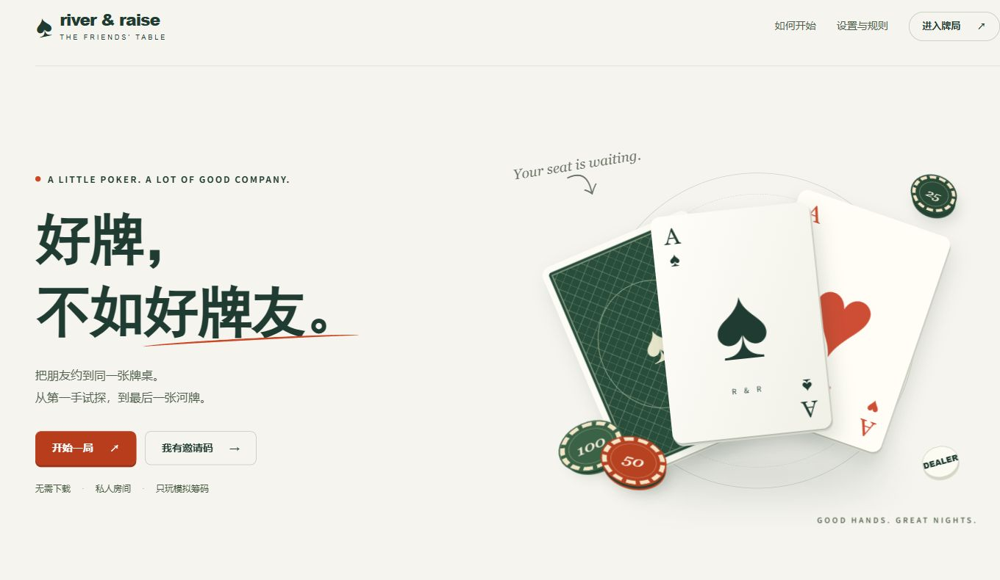

<div align="center">


# River & Raise

**好牌，不如好牌友。**

为 2–10 位朋友准备的私人德州扑克牌桌。打开浏览器，发出邀请码，从第一手玩到最后一张河牌。

[](https://github.com/fujiabao89/Texas-Holdem/actions/workflows/ci.yml)
[](./package.json)
[](./package.json)
[](./LICENSE)

[在线体验](https://riverandraise.app) · [本地运行](#本地运行) · [工程文档](./docs/README.md) · [参与贡献](./CONTRIBUTING.md)

</div>

---

## 一张桌，几位牌友

River & Raise 是一个中文、响应式的 No-Limit Texas Hold’em Web 游戏。暖白页面、深绿牌桌与陶橙点缀，让房间、牌局与赛果保持一致的视觉体验。

| 体验             | 已实现能力                                                        |
| ---------------- | ----------------------------------------------------------------- |
| **私人开桌**     | 创建房间、邀请码加入、选座与准备、房主配置和开局                  |
| **完整比赛**     | 2–10 人单桌 Freezeout、盲注轮转、全下、主池与边池结算、淘汰与排名 |
| **实时联机**     | HTTP + WebSocket、服务端权威状态、断线重连与有序重同步            |
| **有节奏的牌桌** | 发牌与翻牌动画、筹码和动作反馈、音效、音量与减少动态效果设置      |
| **回看这一手**   | 当前玩家视角的手牌历史、时间线详情与权限过滤赛果                  |
| **可验证的规则** | 纯规则引擎、可复现随机模拟、多人联调与真实链路端到端测试          |

**当前阶段：P0 持续完善中。** 核心多人牌局链路已实现；正式发布仍需完成发布证据包、容量与恢复演练等验收，见 [P0 任务总览](./docs/00-project/p0-task-overview.md)。产品仅使用无现金价值的模拟筹码。

<details>
<summary>展开查看产品首页</summary>



</details>

## 本地运行

### 1. 准备环境

- **Node.js 22+**，建议与 CI 一样使用 Node.js 22。
- **pnpm 11.7.0**，版本以根 [package.json](./package.json) 的 `packageManager` 为准。
- 一套独立的 **PostgreSQL 开发数据库**；首次迁移账号需具备创建 schema、表和角色的权限，详见 [迁移说明](./apps/game-server/src/infrastructure/persistence/migrations/README.md)。

```sh
git clone https://github.com/fujiabao89/Texas-Holdem.git
cd Texas-Holdem
npm install --global pnpm@11.7.0
pnpm install --frozen-lockfile
```

依赖维护与冻结锁文件验证见 [依赖补丁验收记录](./docs/03-engineering/dependency-patch-validation.md)。

### 2. 注入本地配置

配置项见 [Web 环境变量样例](./apps/web/.env.example) 和 [Game Server 环境变量样例](./apps/game-server/.env.example)。服务端从进程环境读取配置，**仅复制 `.env.example` 不会自动加载服务端变量**。

以下为 **PowerShell 7** 示例，在接下来启动服务的同一个终端执行。连接串通过交互输入，令牌密钥在本机生成：

```powershell
$env:DATABASE_URL = Read-Host "PostgreSQL 开发库连接串" -MaskInput
$env:DATABASE_SCHEMA = "game"
$env:TOKEN_HMAC_SECRET = node -e "process.stdout.write(require('node:crypto').randomBytes(32).toString('hex'))"
$env:CORS_ALLOWED_ORIGINS = "http://localhost:3000"
$env:NEXT_PUBLIC_API_BASE_URL = "http://localhost:3001"
$env:NEXT_PUBLIC_WS_URL = "ws://localhost:3001/api/v1/ws"
```

macOS / Linux 可通过终端或环境管理工具注入相同变量。若要保留开发房间身份，后续启动应复用同一 HMAC 密钥；密钥轮换与重启边界见 [Room 恢复手册](./docs/05-operations/room-recovery.md)。

### 3. 构建、迁移、开桌

```sh
pnpm build
pnpm --filter @texas-holdem/game-server db:migrate
pnpm dev
```

打开 **[localhost:3000](http://localhost:3000)**，用两个独立浏览器会话创建和加入同一房间，选座、准备后由房主开局。游戏服务默认监听 `3001`，健康检查为 [localhost:3001/health](http://localhost:3001/health)。

> 本地开发使用独立数据库。生产角色与受控迁移按 [数据模型规格](./docs/03-data-model.md) 和 [持久化目录说明](./apps/game-server/src/infrastructure/persistence/README.md) 配置；数据库凭据、HMAC 密钥和玩家令牌均不可提交到仓库或放入 `NEXT_PUBLIC_*`。

## 工程结构

```text
Texas-Holdem/
├── apps/
│   ├── web/                Next.js 玩家客户端
│   └── game-server/        Fastify 实时游戏服务
├── packages/
│   ├── poker-engine/       纯扑克规则与锦标赛引擎
│   └── protocol/           通信 Schema、推导类型与投影契约
├── tests/                  联调、E2E、模拟器与性能验证
├── infra/monitoring/       监控面板、告警与本地演练栈
└── docs/                   产品、工程规格、验收与运行手册
```

| 层       | 技术与边界                                                           | 入口                                                                       |
| -------- | -------------------------------------------------------------------- | -------------------------------------------------------------------------- |
| 客户端   | Next.js 16 · React 19 · Tailwind CSS 4；展示服务端投影、提交玩家命令 | [Web](./apps/web/README.md)                                                |
| 实时服务 | Node.js · Fastify · WebSocket；鉴权、房间调度、权威状态与持久化编排  | [Game Server](./apps/game-server/README.md)                                |
| 规则引擎 | TypeScript；不依赖数据库、网络、UI 或框架                            | [Poker Engine](./packages/poker-engine/README.md)                          |
| 通信契约 | Zod Schema 与推导类型；前后端共享同一份定义                          | [Protocol](./packages/protocol/README.md)                                  |
| 数据存储 | PostgreSQL / Supabase · Drizzle ORM；记录与恢复检查点                | [Persistence](./apps/game-server/src/infrastructure/persistence/README.md) |

客户端不裁决牌局结果，游戏服务不重写引擎规则。完整的数据流与模块边界以 [工程规格索引](./docs/README.md) 为准。

## 验证与测试

```sh
pnpm lint
pnpm typecheck
pnpm build
pnpm test
```

| 按需验证                 | 命令                                                           |
| ------------------------ | -------------------------------------------------------------- |
| 单元 / 扑克规则          | `pnpm test:unit` / `pnpm test:rules`                           |
| 数据库集成 / WebSocket   | `pnpm test:integration` / `pnpm test:ws`                       |
| 浏览器界面               | `pnpm exec playwright install chromium` 后运行 `pnpm test:e2e` |
| 浏览器到数据库的真实链路 | `pnpm test:e2e:real`                                           |
| 牌局时序与弱网           | `pnpm test:e2e:timeline`                                       |
| 可复现的引擎模拟         | `pnpm test:sim -- --seed 20260821`                             |
| 真实链路性能冒烟         | `pnpm test:perf -- --scenario smoke`                           |

数据库测试使用独立的 `TEX_TEST_DATABASE_URL`。未配置时，部分集成测试会受控跳过；真实链路 E2E 会直接报错，不将缺失数据库当作测试通过。浏览器矩阵、运行前提、产物和门禁以 [测试入口](./tests/README.md)、[E2E 指南](./tests/e2e/README.md) 与 [测试策略](./docs/06-testing-strategy.md) 为准。

## 从这里继续

| 想了解什么                         | 阅读入口                                             |
| ---------------------------------- | ---------------------------------------------------- |
| 产品范围与玩法意图                 | [德州扑克项目总规划](./德州扑克项目总规划.md)        |
| 规则、协议、数据、服务端与前端规格 | [工程文档总索引](./docs/README.md)                   |
| 当前阶段与后续工作                 | [P0 任务总览](./docs/00-project/p0-task-overview.md) |
| 重启恢复、监控与运行维护           | [运维文档](./docs/05-operations/README.md)           |
| 分支、Linear 与 Pull Request       | [贡献约定](./CONTRIBUTING.md)                        |
| 安全问题的私密反馈                 | [安全策略](./SECURITY.md)                            |

工作项统一在 **Linear** 跟踪；分支和 PR 按 [贡献约定](./CONTRIBUTING.md) 关联 `TEX-<number>`。Agent 协作以 [AGENTS.md](./AGENTS.md) 为准。项目采用 [Apache License 2.0](./LICENSE)；第三方音效归属见 [音频许可说明](./apps/web/public/audio/THIRD_PARTY_NOTICES.md)。

---

<div align="center">

**The table is yours.**

人齐了，好戏就开场。

</div>
